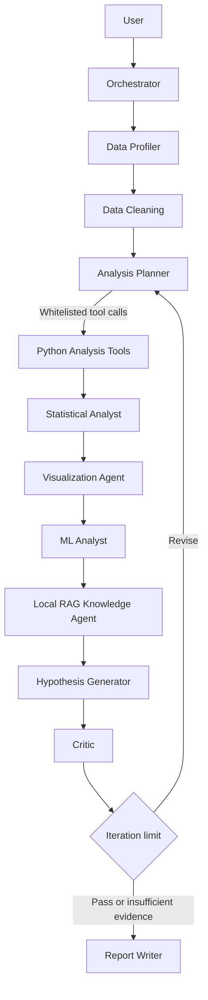

# AI Data Science Team

This project implements a production-oriented multi-agent data science workflow using a local Ollama LLM and deterministic Python analysis tools. The agents work in sequence using a shared state graph, with the critic able to trigger additional analysis before a final report is produced.

## Architecture



## Project Overview

- Accepts a CSV and a natural-language business question.
- Uses a local Ollama model for reasoning and planning.
- Uses Python tools for all numerical analysis and plotting.
- Maintains a structured state and execution trace for auditability.
- Stores intermediate artifacts and logs.
- Validates structured Ollama responses with Pydantic and retries malformed output once.
- Grounds hypotheses and report findings in evidence IDs from measured analysis results.
- Retrieves local domain references through SQLite-backed Ollama embeddings and includes verified source citations.
- Exposes data-science, machine-learning, visualization, and knowledge tools through embedded FastMCP servers.

## Installation

```bash
python -m venv .venv
source .venv/bin/activate  # or .venv\Scripts\activate on Windows
pip install -r requirements.txt
cp .env.example .env
```

## Local LLM Setup

Install and run Ollama locally, then pull a supported model, for example:

```bash
ollama pull qwen3:8b
ollama pull nomic-embed-text
```

Set env values:

```bash
OLLAMA_BASE_URL=http://localhost:11434
OLLAMA_MODEL=qwen3:8b
OLLAMA_EMBEDDING_MODEL=nomic-embed-text
TEMPERATURE=0.1
```

## Running the App

```bash
streamlit run app/ui/streamlit_app.py
```

Or launch the API:

```bash
uvicorn app.main:app --reload
```

The API root (`/`) returns service information, `/health` is the health check,
and `/docs` provides the interactive API documentation. The API does not serve
the Streamlit interface; run the Streamlit command above to use the upload UI.
The Streamlit dashboard shows dataset/cleaning metrics, statistics, validated
hypotheses, model results, plots, errors, and agent/tool execution traces.
After an analysis completes, download the report as Markdown or the complete
structured result and trace as JSON.

Open the **Knowledge & tools** workspace in Streamlit to inspect the local
knowledge index and MCP tool catalog, add Markdown/text/PDF references, and
index or refresh the knowledge base. Indexing and retrieval use the local
Ollama embedding endpoint; no external embedding service is used. The SQLite
index is stored at `data/vectorstore/knowledge.sqlite3` by default.

Set `MCP_ENABLED=false` to explicitly use the registered local Python fallbacks.
The MCP tools accept CSV files only from the configured `UPLOAD_DIR` and
`PROCESSED_DIR` and enforce `MAX_FILE_SIZE_MB`. Knowledge documents must remain
inside `knowledge/` and be Markdown, text, or PDF files.

## Orchestration and Tool Calling

LangGraph owns the execution flow. The profiler and cleaner run before the
analysis planner. The planner may select up to three tools from the registered
data-science catalog. If the model returns no usable tool calls, a deterministic
profile-driven plan runs instead and records that selection in the trace. Tool
names and arguments are validated against schemas; the model cannot pass Python
or shell code for execution. MCP calls and local fallbacks are recorded with
server, tool, status, duration, arguments, and result summaries.

The knowledge agent retrieves supporting methodology from the local index
before hypothesis generation and on each critic revision. Hypotheses and report
findings keep measured evidence IDs separate from domain source paths; citations
are checked against the items actually retrieved. The critic reviews each
hypothesis and the graph routes `REVISE` back to the planner.
`MAX_ANALYSIS_ITERATIONS` bounds these feedback iterations; if that limit is
reached, the final report explicitly records insufficient evidence. Ollama
unavailability or malformed responses are recorded in the state and execution
trace, while deterministic analysis and an evidence-qualified fallback report
remain available.

If requests to `GET /` or `/favicon.ico` return 404, launch the FastAPI app from
the project root with `uvicorn app.main:app --reload` and verify that the
request is going to that port. The root and favicon routes return service
information and HTTP 204 respectively; they do not serve the Streamlit UI.

## Example Usage

```bash
python scripts/generate_demo_dataset.py
python - <<'PY'
from app.services.analysis_service import run_analysis
result = run_analysis('data/uploads/sales_demo.csv', 'Why are sales declining?')
print(result['final_report'][:400])
PY
```

## Testing

```bash
pytest -q
```

## Limitations

- Local LLM quality depends on the installed model and hardware.
- The project keeps the workflow deterministic and auditable rather than relying on uncontrolled LLM execution.
- Advanced causal inference requires domain expertise and additional data.

## Future Improvements

- Add dedicated forecasting and causal-inference workflows where data supports them.
- Add incremental progress streaming while graph nodes execute.
- Add optional PDF export and richer report templates.
